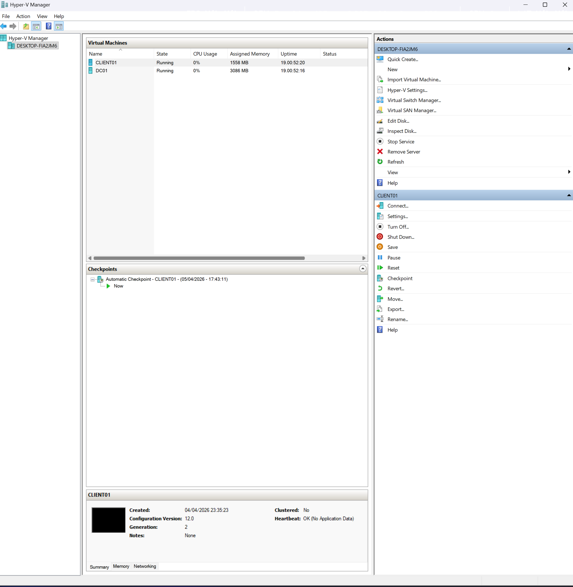
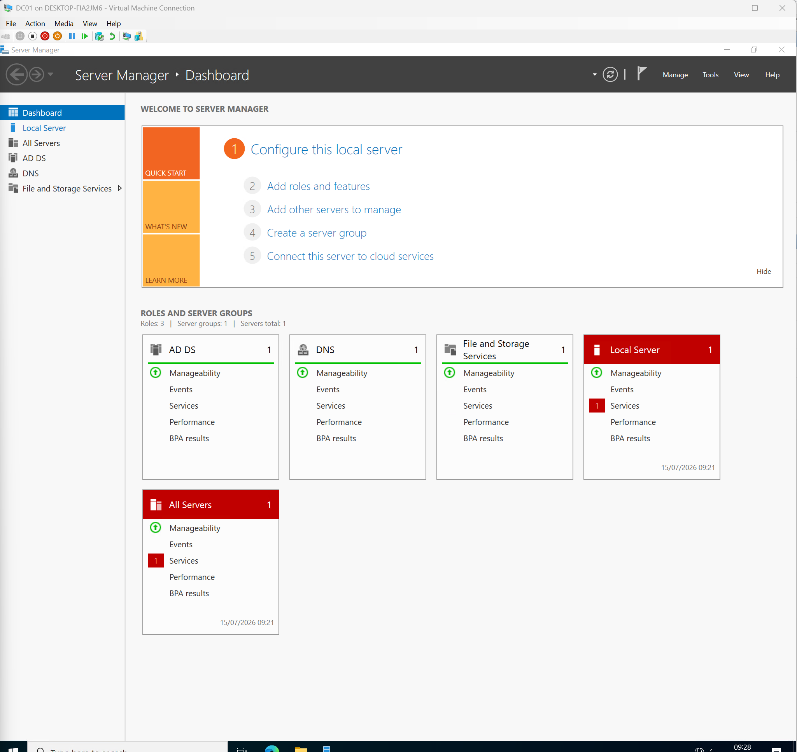
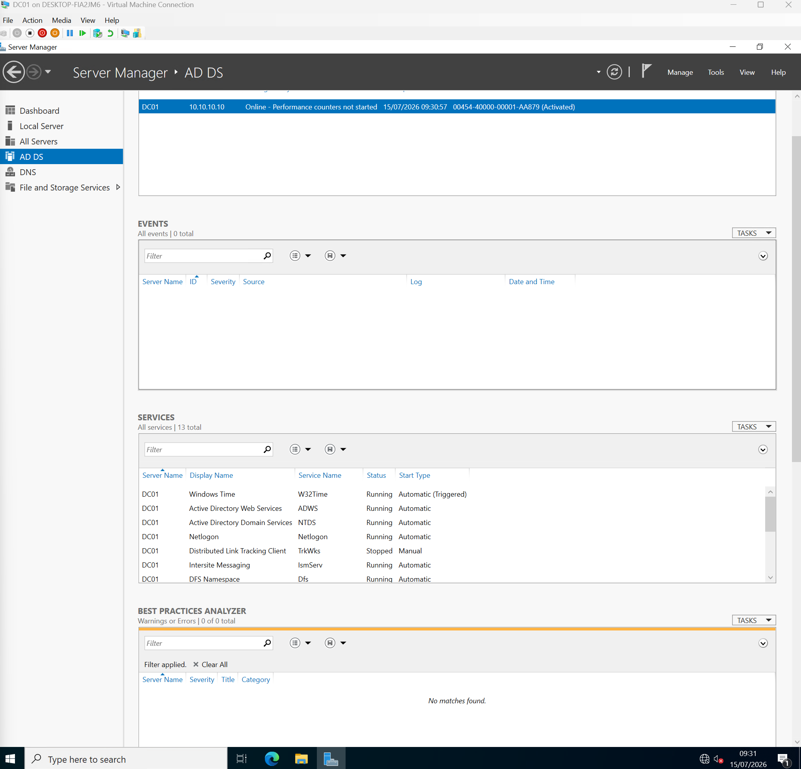
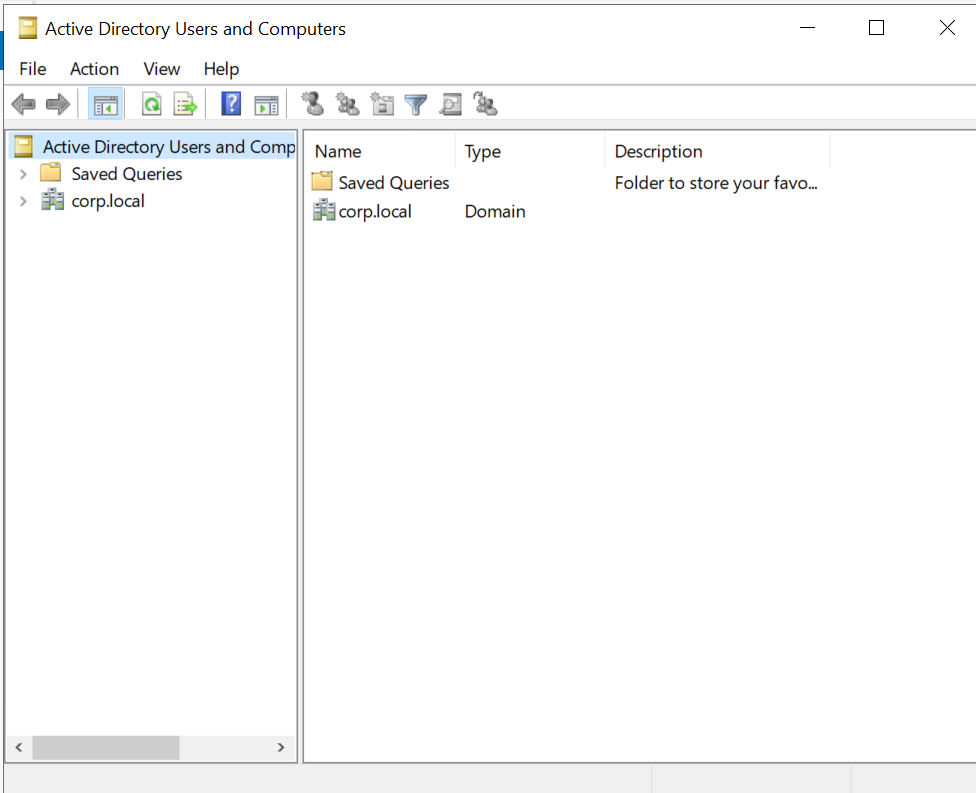
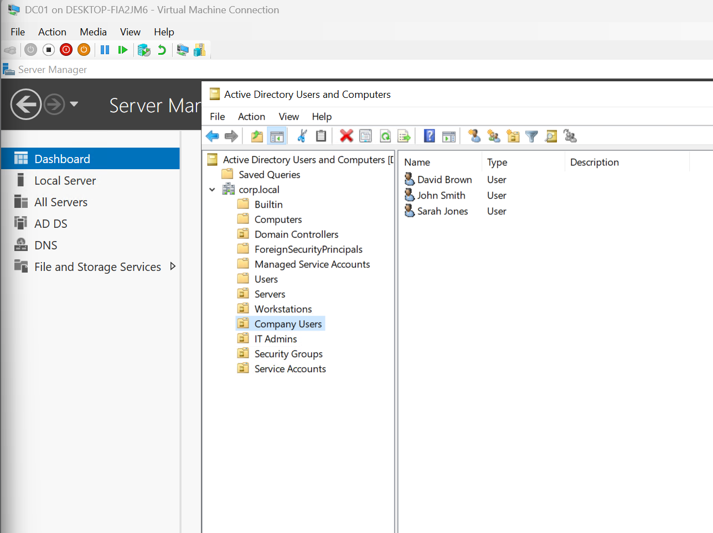
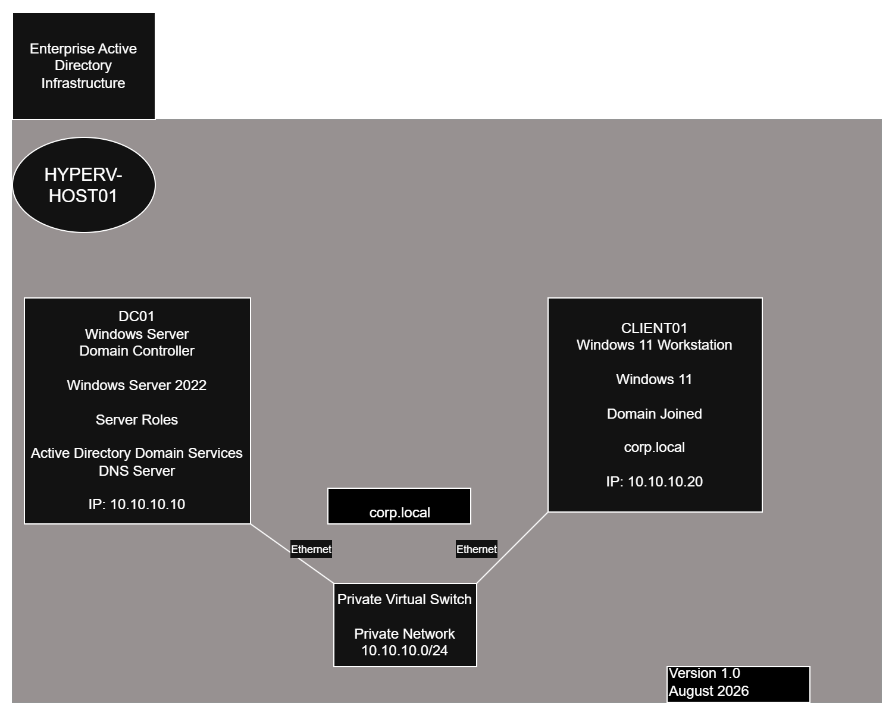

# Enterprise Active Directory Lab

## Project Overview

This project demonstrates the deployment of an enterprise Active Directory environment using Microsoft Windows Server within a Hyper-V virtualised infrastructure.

The objective was to deploy and administer a Windows domain in an isolated virtual lab, covering Active Directory Domain Services (AD DS), DNS, users, groups and Windows infrastructure. Group Policy configuration is a planned extension rather than a completed, demonstrated control.

This lab simulates the type of Active Directory environment commonly found in enterprise IT and Critical National Infrastructure (CNI) organisations.

---

## Technologies

- Windows Server
- Active Directory Domain Services (AD DS)
- DNS
- Hyper-V
- Windows 11
- Group Policy Management tools (configuration/deployment not yet evidenced)
- PowerShell (basic administration)
- Microsoft Management Console (MMC)

---

## Skills Demonstrated

- Active Directory Administration
- Domain Controller Deployment
- DNS Configuration
- User and Group Management
- Organisational Unit (OU) Design
- Windows Server Administration
- Hyper-V Virtualisation
- Security Group Administration
- Windows Infrastructure Support

---

## Lab Architecture

- Hyper-V Host
- Domain Controller (DC01)
- Windows Client (CLIENT01)
- Private Virtual Network

---

## Project Screenshots

### Hyper-V Environment

---

### Server Manager

---

### Active Directory Domain Services

---

### Organisational Unit Structure

---

### Company Users

---

## Reproduction outline

To reproduce the documented approach in a **nonproduction, isolated** Hyper-V environment:

1. Provision a Windows Server 2022 virtual machine (`DC01`) and a Windows 11 client (`CLIENT01`) on a private virtual switch.
2. Install Active Directory Domain Services and DNS on the server; promote it to a domain controller for a **test-only** domain.
3. Create organisational units, sample users and security groups; verify the configuration in Active Directory Users and Computers.
4. Join the client to the domain, then test authentication using a nonprivileged lab account.
5. Capture evidence of the domain join, DNS resolution, user/group configuration and access permissions, avoiding publication of credentials or real personal data.

These are recommended reproduction steps, **not** a claim that every step has a full public log or standalone validation artifact. Public screenshots currently cover Hyper-V, Server Manager, AD DS, OUs and users. Evidence for specific Group Policy deployments and security auditing has not been published.

## Limitations

- This is a simulated enterprise environment, not a deployed or independently assessed production identity service.
- Windows Server, AD DS, DNS, OUs, test users and security groups are reported as configured; individual endpoint and policy outcomes require more detailed reproducible logs.
- Group Policy deployment, password policy enforcement, advanced security auditing and automated provisioning have not been demonstrated.
- The repository's top-level `docs` and `scripts` entries are placeholders rather than published implementation notes or automation scripts.

## Future Improvements

- Group Policy configuration
- Password policies
- Network shares
- DNS troubleshooting
- DHCP deployment
- PowerShell automation
- Security auditing
- Windows Event Log monitoring

## Enterprise Lab Architecture

The lab consists of:

- Windows Server 2022 Domain Controller
- Active Directory Domain Services
- DNS Server
- Windows 11 Domain Joined Workstation
- Hyper-V Virtual Switch
- Private Virtual Network (10.10.10.0/24)

### Architecture Diagram

